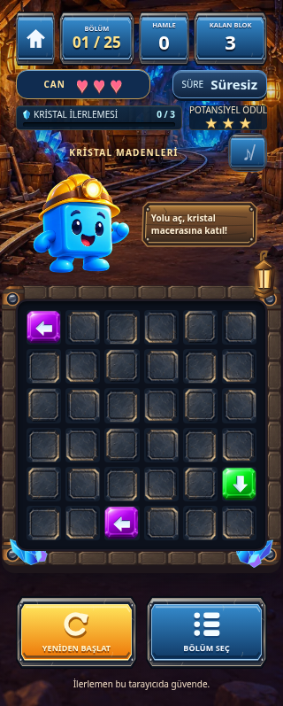
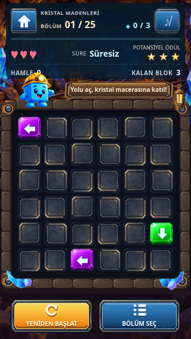
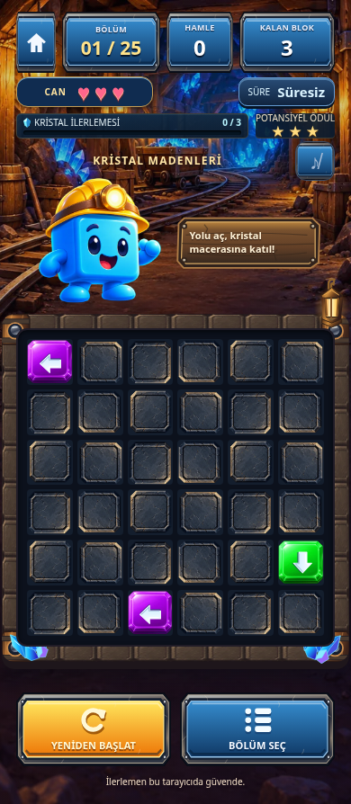
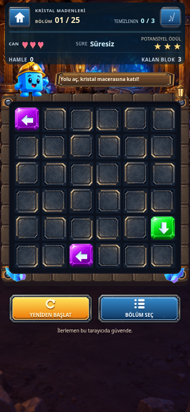

# Block Escape v0.6.4 — Compact HUD Redesign

Dal: `feature/block-escape-v0.6.4-compact-hud`.
Temel: güncel `origin/main`, `e517d5ce0c77ddb859844d77ccb38c569c3ed91d`
(v0.6.3.1 zafer sesi düzeltmesi dahil).

Test edilen uygulama commit SHA: `4802bf569d061d9e8d5578dbcddbc92c0ce5fbc0`.
Bu rapor ve sonuç artefaktları, uygulamayı değiştirmeyen takip belge commit’iyle eklenir.

## Yeni görsel hiyerarşi

Bu değişiklik eski paneli ölçeklemek yerine HTML okuma sırasını yeniden kurar:

1. 44 px ana menü ve müzik düğmeleri arasında dünya adı; altında **bölüm +
   temizlenen/toplam** aynı satırda. 320 px'de temizlenen etiketi görsel olarak
   küçük kristal işaretine bırakılır; tam erişilebilir etiket ve değerler korunur.
2. Ayrı çerçevesiz **4 px kristal ilerleme çizgisi**, yıldız içermiyor.
3. Aynı kompakt satırda canlar, süre ve **potansiyel** ödül. Kazanılmış sonuç
   yıldızlarından anlam bakımından ayrılmaya devam eder.
4. Hamle ve kalan blok, ikincil kısa sayaçlar. Eski büyük HUD kartları kaldırıldı.

Oyun için yeni `compact-hud.css`, mevcut tema dosyalarından sonra yüklenir;
seçiciler gameplay ile sınırlıdır. Taş/maden ve mevcut düğme varlıkları korundu;
kontrast için ince, düz bir lacivert zemin kullanıldı. Yeni resim/kütüphane yok.
Bloop'un madenci kimliği ve varlığı korundu; yardımcı ölçeği ve çerçeve feneri
HUD–tahta arasında daha az yer kaplar. Dekorasyonlar tıklamayı engellemez.
Alt eylemler kısa ekranlara göre düzenlendi; düğmeler en az 44 px'dir.

## Ölçümler

Önce ölçümü, main'in **özgün HTML'i** ayrı Playwright sayfalarında route edilerek
alındı. Çalışma dosyaları resetlenmedi/üzerlerine eski dosyalar yazılmadı.
CSS/oyun motoru/ses/state dosyaları bu kıyasta main ile aynıydı; yeni stil eski
HTML'de yüklenmiyordu. Yeni ölçüm aynı Chromium viewport/font ayarlarında alındı.

Eski HUD+başlık işlevsel alanı 320 px'de **180 px**, diğerlerinde **187 px**;
yeni bütünleşik HUD dört ölçüde **116 px**. Eski çerçeveli panel 28 px idi;
etiketi üst satıra taşınarak artık yalnız 4 px çizgi yer kaplıyor.

| Viewport | Tahta Y önce → sonra | Kazanılan üst alan | Tahta boyutu (aynı) | Belge yüksekliği önce → sonra |
| --- | --- | ---: | --- | --- |
| 320×568 | 338 → 183 px | 155 px | 284×284 px | 797 → 568 px |
| 375×667 | 365 → 199 px | 166 px | 339×339 px | 879 → 667 px |
| 390×844 | 365 → 207 px | 158 px | 354×354 px | 894 → 844 px |
| 430×932 | 365 → 207 px | 158 px | 394×394 px | 934 → 932 px |

Normal oyun dört hedef viewport'ta **yatay ve dikey sayfa taşması olmadan**
sığar. Tahta küçültülmedi; 36 hücrenin kareliği ve blok sınırları korunur.
Önceden 320×568'de tahtanın yaklaşık %81'i, 375×667'de %89'u görünüyordu;
şimdi dört ölçüde de tahtanın tamamı görünür. Kısa ekranlarda yalnızca
tekrarlanan kayıt-güvenliği footer yazısı gizlenir; kayıt sistemi değişmez.

[Ham önce ölçümleri](v064/before.json) · [Ham sonra ölçümleri](v064/after.json).

## Önce / sonra görüntüleri

| 320 px önce | 320 px sonra |
| --- | --- |
|  |  |

| 390 px önce | 390 px sonra |
| --- | --- |
|  |  |

Dört genişliğin tüm ekranları, ilerleme, kazanma ve süre-uyarı örnekleri ayrıca
`/tmp/block-escape-v064/` altında `chromium-compact-*.png` olarak bulunur.
Resimler gerçek Chromium çıktılarıdır; referans/mockup değildir. Rapor PNG'leri
oyun varlıklarına eklenmedi ve uygulama tarafından indirilmez.

## Korunan davranışlar ve erişilebilirlik

`game.js`, `engine/`, `timer-stars.js`, `audio-manager.js`, `audio-ui.js`,
`star-audio.js`, bütün normal/lab JSON'ları ve ses dosyaları main ile aynı kaldı.
Mevcut DOM state ID'leri korundu; ilerleme sayısı/ARIA değerleri, can, süre,
urgency ve potansiyel ödül hesapları aynen kullanılır. Yeni state veya kayıt
anahtarı yok. UNDO eklenmedi. Ana menü ve HUD dışındaki animasyon mantığı aynı.

Mevcut 550 ms kesintisiz dolum/yeniden hedefleme korunur; reduced motion aynı
şekilde geçişi kaldırır. Focus stilleri, native düğmeler ve erişilebilir etiketler
korundu. Safe-area üst/alt kuralları mevcut `max(..., env(...))` ile sürer;
yan padding'ler de sol/sağ safe-area inset'lerini gözetir. Hiçbir taşma body'yi
zorla kırparak veya tahta hücrelerini küçülterek gizlenmedi.

## Test kapsamı

- Altı mevcut Node paketi: **38 test**. Seed tekrarlanabilirliği ve normal/lab
  çözüm doğrulayıcıları da çalıştırılır.
- Mevcut 16 Chromium paketi + yeni `compact-hud-browser.cjs` = **17 paket**.
  v0.6.3.1 zafer sesinin doğal bitişi, kaynak temizliği ve müzik devamı dahildir.
- Yeni HUD paketi: 4 px çizgi ve aynı satırdaki bölüm/sayı, okunabilir ana
  değerler, 44 px eylemler, çakışmayan can/süre/ödül, viewport taşması olmaması,
  küçülmeyen tam görünür tahta ve en az 140 px üst alan kazanımı.
- Gerçek ara doluluk ve yeni hedefe geçiş, tamamlanma/Retry, kare hücrelerin
  belge koordinatları, kazanma ekranı ve ana menü dönüşü denetlenir.
- Sahte saatle can kaybı/potansiyel düşüşü, 10 saniye urgency, timeout ve Retry;
  collision laboratuvarında üç can kaybı/failure/menü dönüşü denetlenir.
- Eski HUD testleri büyük panel/kart yapısına bağlı kabuller yerine yeni
  hiyerarşiyi kontrol eder. Art testi artık Bloop için 140 px zorlamaz; en az
  90 px görünür yardımcıyı ve tahta üzerinde taşmamasını denetler. Gerçek
  asset kimliği, hit-target, texture cache ve bütün tahta kontrolleri korunur.

## Bilinen sınırlar

WebKit çalıştırma denemesi motor dosyası `webkit-2336/pw_run.sh` bulunmadığı
için başarısız. [WebKit çıktısı](v064/webkit.log). Gerçek iPhone Safari veya
Android donanım doğrulaması yapılmadı; Chromium dokunma emülasyonu bu kapsamda
sunulmaz. Gerçek notch/safe-area değerleri ve kullanıcı büyütülmüş metin
ayarları cihazda ayrıca denenmelidir.

Taşmasız ölçümler belirtilen dört portrait CSS viewport'u ve varsayılan font
ayarları içindir. Daha kısa ekranlarda, yatay kullanımda veya uzun laboratuvar
öğretici açıklamalarında bilinçli dikey kaydırma gerekebilir. Lab metinleri
kırpılmaz; güvenli alan için etkileşimli içerik saklanmaz.

## Değişen dosyalar

- `index.html`: yeni semantic HUD sırası ve 0.6.4 başlığı.
- `compact-hud.css` (yeni): yalnız gameplay yerleşimi/typography/spacing.
- `tests/compact-hud-browser.cjs` (yeni), `tests/run-browser.cjs`.
- `tests/art-upgrade.cjs`, `tests/crystal-mines.cjs`, `tests/hud-polish-browser.cjs`:
  yeni yerleşime uygun beklentiler.
- `README.md`, `AGENTS.md`, bu rapor ve `reports/v064/` ölçüm/görüntü/logları.

## Sonuç

**38/38 Node testi ve 17/17 Chromium paketi başarılı**, son toplu Chromium
çıkış kodu 0. [Node çıktısı](v064/node.log) · [Chromium çıktısı](v064/chromium.log).
Seed tekrar üretimi ve bütün bölüm doğrulayıcıları, sözdizimi ve whitespace
kontrolleri başarılı. 25 bölüm dört mobil genişlikte toplam 1.500 gerçek dokunma
hamlesiyle oynandı; iki laboratuvar ve zafer sesinin doğal bitiş testleri geçti.
Normal ekran dört hedef viewport'ta kaydırmasız; tahta boyutları aynı.

17 paket: browser, animations, board-geometry, mobile-grid, menu, reference-menu,
settings, gameplay-ui, crystal-mines, art-upgrade, level-system-browser,
collision-browser, timer-stars-browser, hud-polish-browser, audio-system-browser,
victory-audio-browser, compact-hud-browser.

İlk ölçüm denemesi yerel HTTP sunucusu kapalı olduğu için başlayamadı; 8080
sunucusu açıldıktan sonra ölçümler tamamlandı. Bu bir uygulama testi hatası
değildi. Son koşuda başarısız Node/Chromium testi yok; WebKit kapsamı ortam
nedeniyle eksik. Yayın, GitHub Pages deploy veya main merge yapılmadı.
